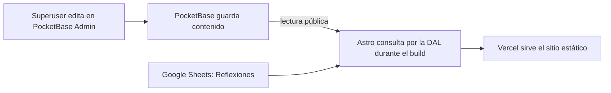

# Flujo actual de datos

Estado revisado **2026-11-02**. El inventario por entidad y sus evidencias
están en el [estado de migración](../migration/README.md).

PocketBase es la fuente de verdad de los datos operativos migrados. El sitio es
estático: guardar un cambio en PocketBase no actualiza la página publicada hasta
que se genere y despliegue un nuevo build.

## Qué vive en PocketBase

Las colecciones operativas actuales son `districts`, `groups`, `posts`,
`events`, `literature`, `categories`, `radio_broadcasts`, `tags` y el singleton
`site_settings`. Las páginas consultan estos datos por la DAL, no directamente
desde los componentes.

- Noticias publicadas, incluido su texto, portada y galería de imágenes.
- Distritos 1, 2, 4 y 5 y sus grupos.
- Eventos, literatura y su inventario.
- Participaciones de radio identificadas por `broadcastDate`.
- Configuración global migrada a `site_settings`.

Las fuentes JSON y Markdown de V1 que todavía necesitan los scripts de
migración se conservan en el repositorio, pero ya no son fallback de ejecución
para noticias, grupos ni literatura.

## Qué sigue fuera de PocketBase

**Reflexiones** continúa en Google Sheets y se lee mediante
`PUBLIC_SHEET_URL`. No se ha autorizado migrarlo.

## Lectura y edición

El frontend solo lee datos publicados mediante la API pública de PocketBase. Las
ediciones se hacen en PocketBase Admin con una cuenta superuser. El registro
público de cuentas `users` está deshabilitado; los usuarios nuevos solo pueden
ser creados por un superuser. No existe todavía un panel con permisos para una
persona que solo edite posts; ese trabajo queda para V2.1.

## Build y despliegue

Durante el build, Astro consulta PocketBase a través de la DAL para generar
páginas estáticas. También lee Reflexiones de Google Sheets. Por eso cada entorno
que construya el sitio debe configurar sus propias variables:

- `PUBLIC_POCKETBASE_URL`: dirección base de PocketBase.
- `PUBLIC_SHEET_URL`: dirección del servicio de Google Sheets para Reflexiones.

Vercel y GitHub Actions no comparten sus variables automáticamente. Como ambas
empiezan con `PUBLIC_`, Astro las puede incluir en recursos enviados al
navegador; no deben contener credenciales privadas.

Después de editar contenido en PocketBase, el equipo debe crear el siguiente
build/deployment y revisar la vista previa antes de dar por terminado el cambio.

## Trabajo diferido a V2.1

- Panel de edición de posts para una persona con permisos limitados.
- Decisión y configuración de backups y recuperación.
- Cualquier cambio de presentación para intercalar imágenes con el texto del
  cuerpo de una noticia.
