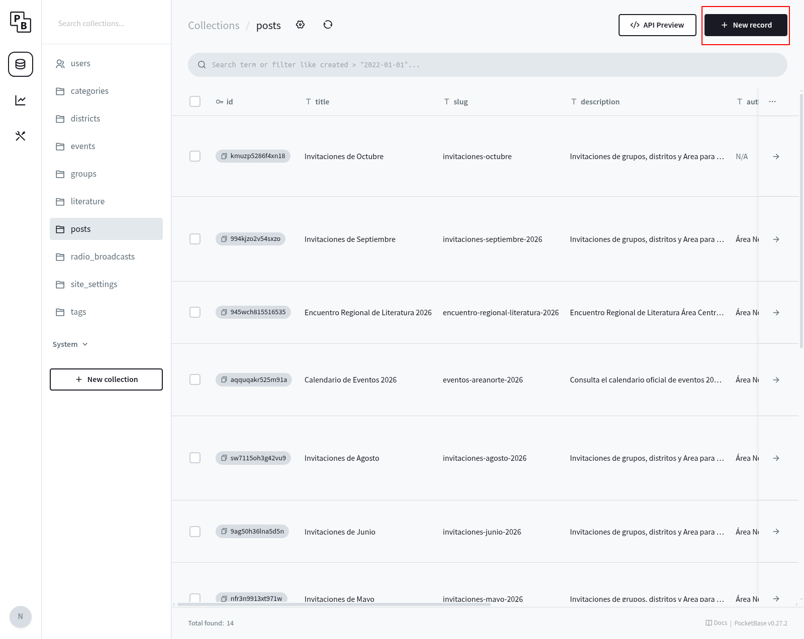
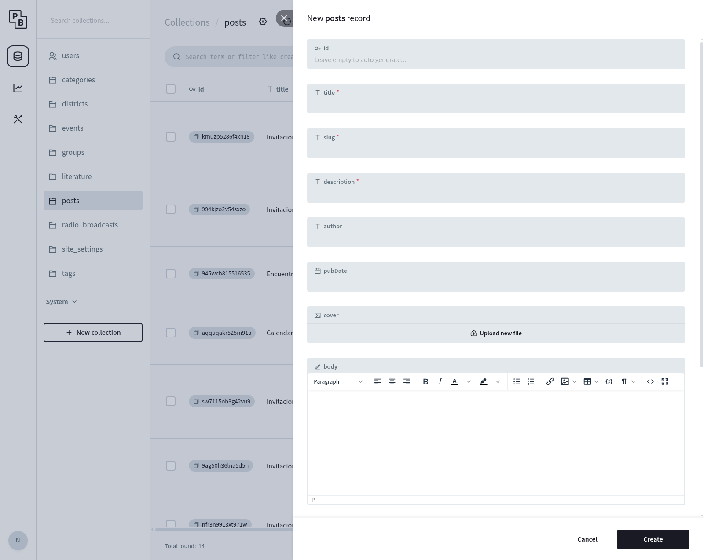
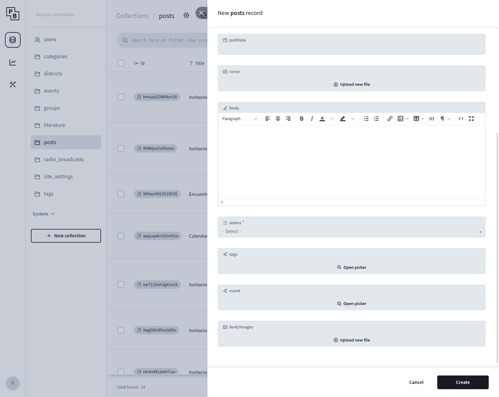
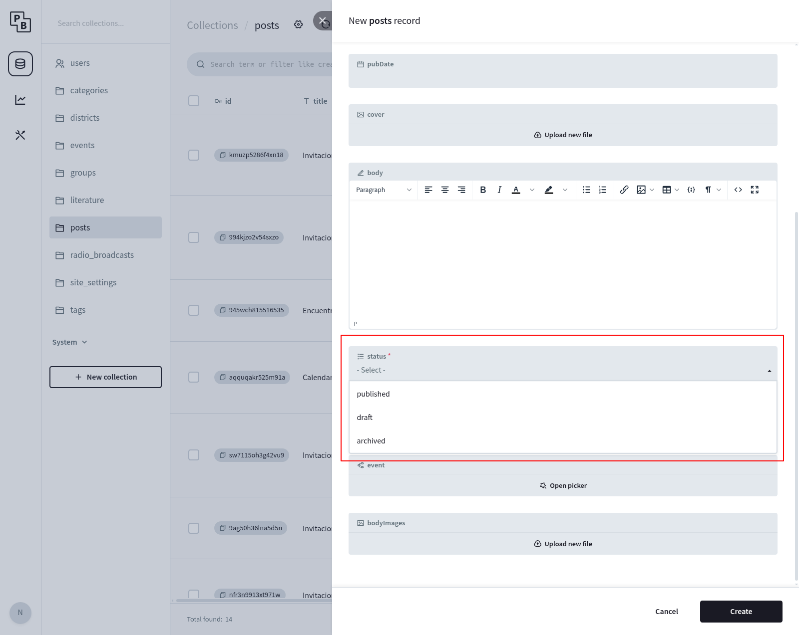
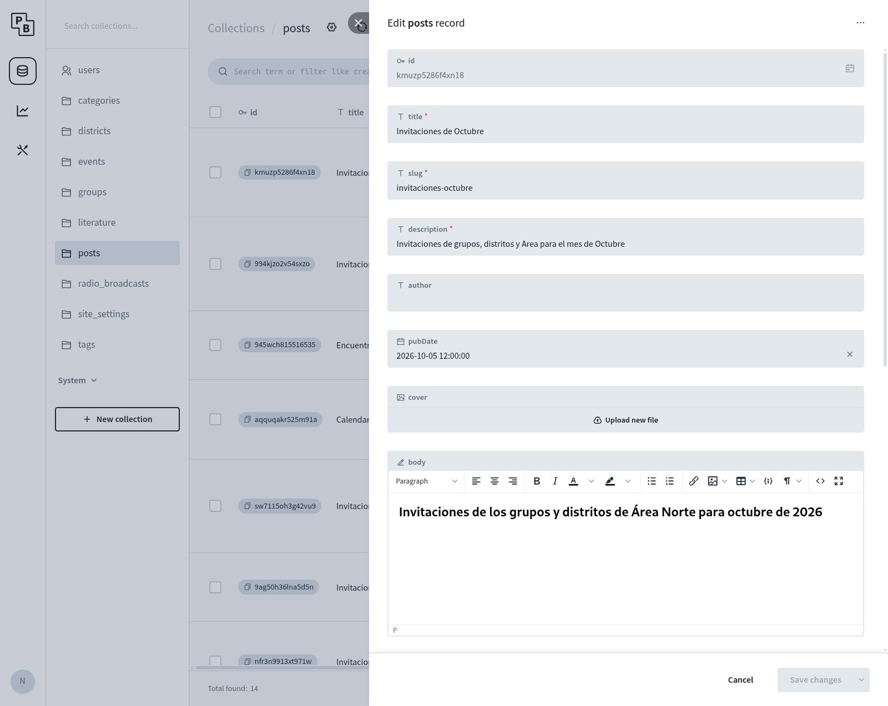
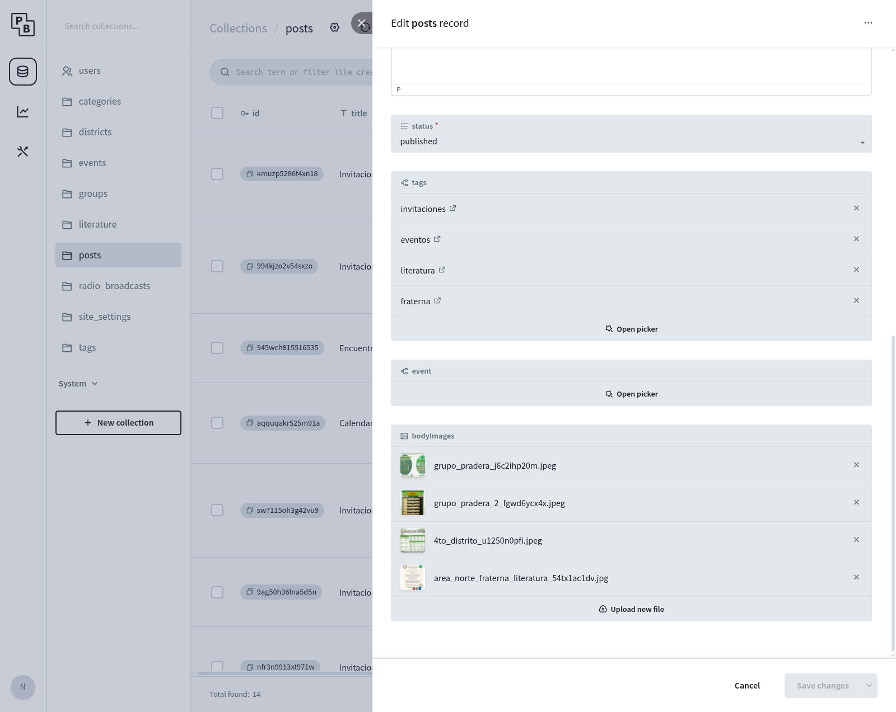

# Cómo publicar y actualizar una noticia

Esta guía explica, paso a paso y sin conocimientos técnicos, cómo crear una
noticia con imágenes o cambiar una noticia que ya existe.

Los botones de PocketBase aparecen en inglés. En cada paso indicamos el nombre
que verás en pantalla y lo que significa en español.

## Antes de empezar

Ten a la mano el título, un resumen, el texto que quieres publicar y las
imágenes. Solo se aceptan imágenes: no subas videos ni archivos PDF. Puedes
agregar hasta 20 imágenes a una noticia. Conserva una copia de las imágenes en
tu computadora.

No compartas tu contraseña. Al enviar capturas para pedir ayuda, revisa que no
aparezcan correos personales ni información de acceso.

## Abrir la sección de noticias

1. Entra al panel de PocketBase con tu cuenta administradora.
2. En la columna de la izquierda, busca y selecciona **posts**. Esta palabra
   significa “noticias”.
3. Verás las noticias que ya existen. Para crear una nueva, pulsa **New record**
   (“Crear registro nuevo”). Para cambiar una existente, pulsa su fila.

<figure>

<figcaption>Selecciona posts y luego New record para crear una noticia.</figcaption>
</figure>

## Crear una noticia

Al pulsar **New record** se abre un formulario. Puedes avanzar por él desplazando
la ventana hacia abajo.

<figure>

<figcaption>Los campos con asterisco rojo son obligatorios.</figcaption>
</figure>

Completa los campos así:

- **title** (“Título”): escribe el título que verá la gente.
- **slug** (“Dirección corta”): escribe el título en minúsculas, con guiones en
  lugar de espacios y sin acentos. Por ejemplo: `invitaciones-octubre`. Debe ser
  distinto al de las demás noticias. Una vez publicada, evita cambiarlo porque
  modifica la dirección de la página.
- **description** (“Resumen”): escribe una o dos frases que expliquen de qué
  trata la noticia.
- **author** (“Autor”): complétalo solo si sabes qué nombre debe aparecer.
- **pubDate** (“Fecha”): indica la fecha correspondiente cuando la conozcas.
- **id**: déjalo vacío; PocketBase lo completa automáticamente.

Más abajo verás estos campos:

- **cover** (“Portada”): imagen opcional que puede aparecer como portada de la
  noticia.
- **body** (“Texto”): escribe una breve introducción. Por ejemplo: “Estas son las
  invitaciones de los grupos y distritos para octubre”.
- **bodyImages** (“Imágenes”): pulsa **Upload new file** (“Subir archivo”) y
  elige las imágenes desde tu computadora. Repite para agregar más. Revisa los
  nombres y el orden en que aparecen: ese será el orden de la galería en la web.
- **tags** (“Temas”): opcional. Elige los temas que correspondan; si no estás
  segura, déjalo vacío.
- **event** (“Evento relacionado”): opcional. Déjalo vacío si la noticia no
  corresponde a un evento ya creado.

Las imágenes de **bodyImages** aparecen juntas en una galería debajo del texto.
No hace falta insertarlas dentro de **body** ni relacionarlas una por una. Para
que aparezcan en la galería, súbelas en **bodyImages**. No uses el botón para
insertar una imagen dentro del editor de texto.

<figure>

<figcaption>El campo body es para el texto; bodyImages es para las imágenes de la galería.</figcaption>
</figure>

### Guardar como borrador o publicar

El campo **status** (“Estado”) es obligatorio. Elige una opción:

- **draft** (“Borrador”): la noticia queda guardada para revisarla. Es la opción
  recomendada mientras todavía estés trabajando.
- **published** (“Publicado”): indica que la noticia está lista para mostrarse
  en la web.
- **archived** (“Archivado”): oculta una noticia anterior sin borrarla.

<figure>

<figcaption>Si aún falta revisar algo, elige draft. Usa published cuando todo esté listo.</figcaption>
</figure>

Antes de guardar, revisa el título, el resumen, el texto, el estado y las
imágenes. Cuando todo esté correcto, pulsa **Create** (“Crear”) al final del
formulario. La captura muestra el formulario todavía sin guardar; después de
crear, la noticia debe aparecer en la lista.

## Cambiar una noticia existente

1. En **posts**, busca la noticia y pulsa su fila.
2. Revisa el título y el texto. Cambia solo lo que necesites.
3. Para agregar imágenes, pulsa **Upload new file** en **bodyImages**. Para
   quitar una imagen, pulsa la **X** que aparece junto a ese archivo. Antes de
   quitarla, asegúrate de que ya no se necesite.
4. Revisa el campo **status**. Si la noticia está publicada y quieres que siga
   visible, déjalo en **published**.
5. Pulsa **Save changes** (“Guardar cambios”) cuando hayas terminado.

Las siguientes capturas muestran Invitaciones de Octubre como ejemplo. Solo
consúltalas; no cambies esa noticia para practicar.

<figure>

<figcaption>Parte superior: título, dirección, resumen, autor, fecha y texto.</figcaption>
</figure>

<figure>

<figcaption>Parte inferior: estado, temas e imágenes que ya están en la galería.</figcaption>
</figure>

## ¿Cuándo aparece el cambio en la página?

Guardar en PocketBase no actualiza la página publicada de inmediato. Después de
crear o cambiar una noticia, hace falta generar una nueva versión del sitio. Si
no sabes cómo hacerlo, avisa a la persona que administra la página. Luego hay
que revisar la vista previa para confirmar que el texto y las imágenes se vean
bien antes de considerar terminado el cambio.

## Revisión rápida

Antes de terminar, comprueba lo siguiente:

- El título y el resumen están completos y bien escritos.
- El texto explica qué muestran las imágenes.
- Elegiste **draft** si todavía falta revisar algo, o **published** si ya está
  listo para mostrarse.
- Las imágenes correctas aparecen en **bodyImages** y en el orden esperado.
- Conservaste una copia de las imágenes en tu computadora.

Si algo no aparece en la página, no crees otra noticia con el mismo contenido.
Pide ayuda e indica el título de la noticia y qué esperabas ver.

## Si otra persona necesita acceso

El registro abierto está deshabilitado. Para pedir una cuenta, contacta a la
persona administradora. El acceso para alguien que solo pueda editar noticias
se añadirá en una versión futura.
